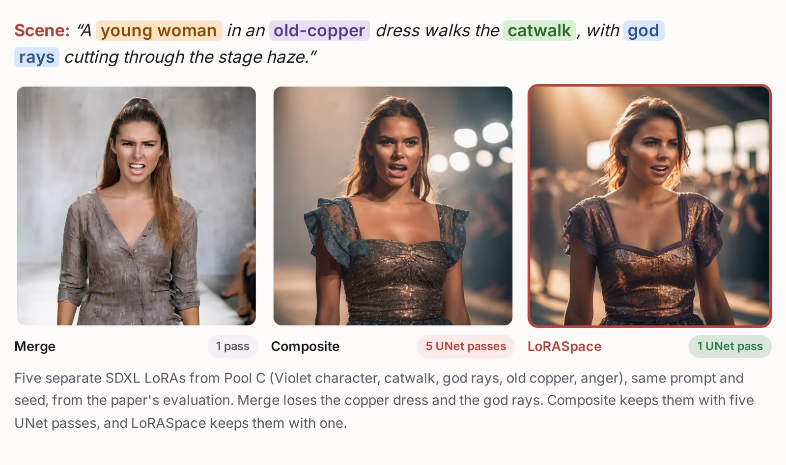
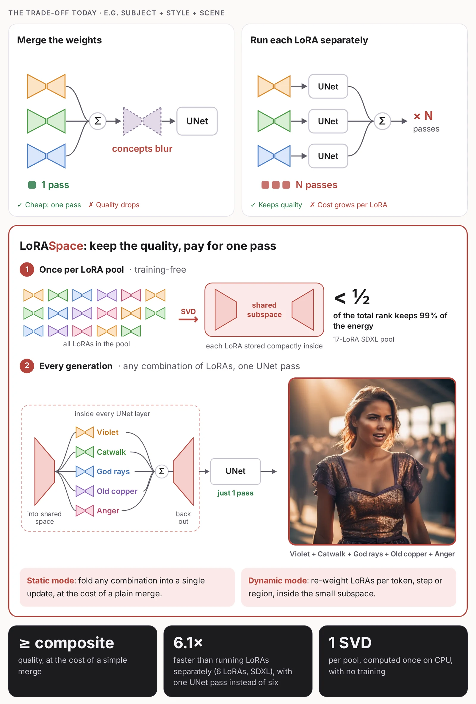

# LoRASpace

**A Pool-Wide Shared Substrate for Static and Dynamic Multi-LoRA Composition** (NeurIPS 2026)

Thamirawaran Sathiyalogeswaran, Navindu De Silva, Chamikara Siriwardane, W K Alwis, Jason Mars, Udaya Sampath K. Perera Miriya Thanthrige, Ranga Rodrigo

[Project page](https://thamirawaran.github.io/loraspace) | [Paper (OpenReview)](https://openreview.net/forum?id=edpJ8ipgAp) | [LoRA pools](https://huggingface.co/datasets/Thamirawaran/loraspace-pools)



<sub>Five Pool C LoRAs (Violet character, catwalk, god rays, old copper, anger), same prompt and seed, from the paper's evaluation.</sub>

LoRAs in the same pool overlap heavily in their low-rank factors. LoRASpace computes one shared subspace per pool (paired SVDs of the stacked factors, kept at 99% energy) and re-expresses every LoRA inside it. Any combination of LoRAs from the pool then composes in that subspace:

- **Static mode** folds the combination into one weight delta, so inference costs the same as a single merged LoRA.
- **Dynamic mode** keeps the LoRAs separate inside the subspace and lets a router weight them per token, per step or per region, in one forward pass instead of one pass per LoRA.

Both modes use the same precomputed subspace.



More figures, including the precompute and what happens inside one layer, are on the [project page](https://thamirawaran.github.io/loraspace).

## Install

```bash
git clone https://github.com/Thamirawaran/loraspace && cd loraspace
pip install -e ".[diffusion]"     # SD 1.5 / SDXL
pip install -e ".[llm]"           # LLM hybrid routing
```

## Quick start

**1. Get a pool and build its subspace once.** The three diffusion pools from the paper are listed in [`pools/`](pools). Any set of kohya-format SD 1.5 or SDXL LoRAs works too.

```bash
python pools/download_adapters.py --pool pool_c          # 17 SDXL LoRAs
python examples/precompute_pool.py --pool pool_c --out pool_c.pt
```

```python
from loraspace import precompute_pool

cache = precompute_pool({"lighting_3": "adapters/pool_c/lighting_3.safetensors", ...})
print(cache.summary())   # D (subspace size per layer) and rank fill rho = D / sum of ranks
cache.save("pool_c.pt")
```

The rank fill ρ tells you how much the pool overlaps: ρ = 1 means no overlap, and the paper's diffusion pools sit at 0.46 to 0.57. Pools with ρ close to 1 compress little.

**2. Compose.**

```python
import torch
from diffusers import StableDiffusionXLPipeline
from loraspace import LoRASpacePipeline, PoolCache, SpatialRouter

pipe = StableDiffusionXLPipeline.from_pretrained(
    "stabilityai/stable-diffusion-xl-base-1.0", torch_dtype=torch.float16, variant="fp16").to("cuda")
ls = LoRASpacePipeline(pipe, PoolCache.load("pool_c.pt"), scale=0.8)

ls.compose(["character_1", "material_2", "lighting_3"])                              # static mode
ls.compose(["character_1", "material_2", "lighting_3"], router=SpatialRouter(3))     # dynamic mode
image = ls("CamelliaXL, a young woman at an old wooden table, chiaroscuro style").images[0]
ls.reset()   # restore the original UNet
```

[`examples/sdxl_compose.py`](examples/sdxl_compose.py) runs both modes with the paper's settings.

## Routers

Dynamic mode accepts any `loraspace.Router`. Included:

| Router | Weights | |
|---|---|---|
| `UniformRouter` | 1/N everywhere (equal to static mode) | default in the paper |
| `SpatialRouter` | per token, top-k by normalised activation energy | in the spirit of SpectR |
| `TemporalRouter` | per denoising step, a dominant LoRA schedule | following CMLoRA |
| `SemanticRouter` | per region, from per-LoRA spatial masks you provide | e.g. FreeFuse masks |
| `LLMRouter` | per token, top-k by norm-calibrated energy | used by the LLM hybrid |

Writing a router means implementing `weight_outputs(x_proj, y)`, which maps the per-LoRA subspace outputs `y` of shape (B, N, S, D) to one (B, S, D) output.

## LLMs

For causal LMs with PEFT LoRAs, `loraspace.llm` builds the same subspace and pairs it with retrieval: an INSTRUCTOR retriever proposes candidate LoRAs for each prompt and `LLMRouter` mixes the top-k per token.

```python
from loraspace.llm import precompute_llm_pool, compute_adapter_norms, InstructorRetriever, LoRASpaceLLM

cache = precompute_llm_pool({name: f"Styxxxx/llama2_7b_lora-{name}" for name in names})
ls = LoRASpaceLLM(model, tokenizer, cache, retriever=InstructorRetriever(samples),
                  adapter_norms=compute_adapter_norms(model, tokenizer, cache, calibration_prompts))
print(ls.generate("Is this review positive? The film was a delight."))
```

[`examples/llm_hybrid.py`](examples/llm_hybrid.py) runs this on the 48 LoRA-Retriever LLaMA-2-7B LoRAs.

## Notes

- The subspace is built for a fixed pool. Adding or removing a LoRA means rebuilding the cache (minutes on CPU for 17 SDXL LoRAs).
- Linear and 1x1 convolution layers are composed. 3x3 convolution LoRA layers are skipped.
- `LoRASpacePipeline` assumes no other LoRAs are loaded on the pipeline.

## LoRA pools and licenses

The pool manifests in [`pools/`](pools) list every LoRA with its Civitai source, creator, sha256 and whether it is hosted. All LoRAs are third-party work. 25 are mirrored, unmodified, in [Thamirawaran/loraspace-pools](https://huggingface.co/datasets/Thamirawaran/loraspace-pools) with credits. 6 are fetched from Civitai because their creators do not allow redistribution. The 3 Pool A character LoRAs depict real people, were removed from Civitai and are not redistributed, so Pool A and Pool B can only be rebuilt without them.

## Citation

```bibtex
@inproceedings{sathiyalogeswaran2026loraspace,
  title     = {LoRASpace: A Pool-Wide Shared Substrate for Static and Dynamic Multi-LoRA Composition},
  author    = {Sathiyalogeswaran, Thamirawaran and De Silva, Navindu and Siriwardane, Chamikara and Alwis, W K and Mars, Jason and Perera Miriya Thanthrige, Udaya Sampath K. and Rodrigo, Ranga},
  booktitle = {Advances in Neural Information Processing Systems},
  year      = {2026}
}
```

## Acknowledgements

The computational resources for this research were supported by the Accelerating Higher Education Expansion and Development (AHEAD) Operation Grant No. 6026-LK/8743-LK from the Ministry of Higher Education, Sri Lanka, funded by the World Bank. R. Rodrigo acknowledges the University of Moratuwa Senate Research Committee Grant No. SRC/LT/2021/20. We also thank Jaseci Labs for its support, the creators of the LoRAs in our pools, and the authors of LoRA-Retriever for their adapters and retriever.

## License

Code: MIT. The LoRAs keep their creators' terms and the CreativeML OpenRAIL-M / Open RAIL++-M licenses of their base models.
